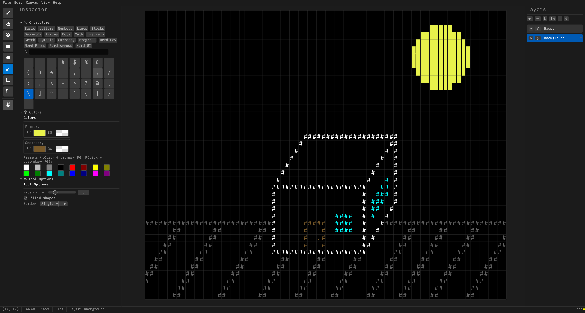

# 🎨 Void Canvas

A terminal-aesthetic ASCII art editor built with Rust, [egui](https://github.com/emilk/egui) and [eframe](https://github.com/emilk/egui/tree/master/crates/eframe).



---

## Features

| Category | Details |
|---|---|
| **Tools** | Select, Brush, Pixel, Shade, Eraser, Flood Fill, Gradient, Eyedropper, Text, Line, Rectangle, Ellipse, Border Box — left button uses the primary slot, right button the secondary; Shift / Alt square or centre shapes |
| **ASCII art** | **Pixel** paints pixels inside cells: half blocks (`▀▄█`, 1×2, two colours per cell), quarters (2×2), sixths (2×3) or braille dots (2×4, `⣿`); **Shade** steps density (`░▒▓█`, ` .:-=+*#%@`); **Gradient** fills the selection with a linear or radial ramp of glyphs (dithered) and colours (blended in OKLab); box lines and borders **join automatically** (`├ ┬ ┼`, double lines too); **symmetry** mirrors strokes and turns glyphs to match |
| **Pictures** | Import PNG / JPEG / GIF / WebP as half blocks, ASCII, shades or braille — colour or mono, dithering, brightness / contrast, live preview |
| **Banners** | Big FIGlet letters (Standard, Small, Slant, Big, Shadow, Mini, Banner) |
| **Paint channels** | Glyph / Fore / Back toggles: paint, fill, erase or pick only the character, only the colour, or only the background |
| **Selection** | Move by dragging or with the arrow keys, glyph-aware Flip / Rotate (`/` ↔ `\`, `┌` ↔ `┐`, `▌` ↔ `▐`, …) |
| **Layers** | Add / Remove / Duplicate / Merge Down / Reorder / Rename / Lock / Hide; opacity and **blend modes**: *Normal* (a glyph replaces the one below), *Combine* (glyphs join into one real character where Unicode has it: `│`+`─` = `┼`, braille dots, quarter / sixth blocks, `/`+`\` = `X` — still plain text), *Overlay* (glyphs drawn over each other; text export keeps the top one and says so) |
| **History** | 100-step Undo / Redo for everything, with a History panel to jump to any step |
| **Glyphs** | 21 sets (Lines, Box, Blocks, Braille, Sextants, Math, Greek, Arrows, Nerd icons, …) plus **your own sets** (type or paste glyphs, add the primary glyph or every glyph of the selection, edit, rename, copy as text), recent glyphs; search by name, code point (`U+2588`) or any typed character |
| **Colors** | Primary & secondary foreground / background slots, live RGBA picker, hex input, recent colours, VGA / xterm 256 / PICO-8 / Game Boy palettes; Replace (Ctrl+H) recolours or swaps glyphs across a layer |
| **Canvas** | Terminal-style 1:2 cells; box-drawing, block and braille characters are drawn as shapes so they join seamlessly at any zoom; fit / 100 % zoom, optional grid |
| **Clipboard** | Copy / cut / paste selections, also as plain text to and from other programs |
| **Animation** | Aseprite-style timeline (layers × frames, a dot per cel, drag frame numbers to reorder, hover for a preview, right click for duration and more), playback (`Enter`), `,` / `.` to step, onion skin of the active layer, undo that returns to the frame it changed; layers are shared by all frames; **GIF** export |
| **Scripting** | Edit → Script…: small [Rhai](https://rhai.rs) programs draw on the active layer (cells, text, lines, colours, noise, random, frames); examples included, `Ctrl+Enter` runs, a whole run is one undo step |
| **Tabs** | Several documents at once, each with its own undo history, view and selection; `Ctrl+Tab` switches, `Ctrl+W` closes, quitting asks about each unsaved tab |
| **Command palette** | `Ctrl+Shift+P` / `F1`: fuzzy-search every menu action, tool, layer action, palette and recent file; recently used commands come first |
| **Files** | Compact native `.vc` format ([see below](#file-format)), `.txt` import / export, **ANSI** (24-bit colour) and **HTML** export, **PNG** export (opaque or transparent), animated **GIF** export, copy as text / ANSI, recent files, drag & drop, autosave of every unsaved tab with crash recovery |

---

## Installation

### Pre-built binaries

Download the latest release for your platform from the [Releases](../../releases) page.

### Build from source

**Requirements:** Rust 1.92+ and Cargo.

```bash
git clone https://github.com/the-void-fox/VoidCanvas
cd VoidCanvas
cargo build --release
./target/release/void_canvas          # Linux / macOS
./target/release/void_canvas.exe      # Windows
```

---

## Keyboard Shortcuts

### File

| Shortcut | Action |
|---|---|
| `Ctrl+Shift+P` / `F1` | Command palette |
| `Ctrl+N` | New document |
| `Ctrl+O` | Open `.vc` file |
| `Ctrl+S` | Save |
| `Ctrl+Shift+S` | Save as… |
| `Ctrl+W` | Close tab |
| `Ctrl+Tab` / `Ctrl+Shift+Tab` | Next / previous tab |
| Drop a file on the window | Open `.vc` / `.txt`, or import a picture |

### Edit

| Shortcut | Action |
|---|---|
| `Ctrl+Z` | Undo |
| `Ctrl+Y` / `Ctrl+Shift+Z` | Redo |
| `Ctrl+C` | Copy selection (also as plain text to the system clipboard) |
| `Ctrl+X` | Cut selection |
| `Ctrl+V` | Paste at cursor (text copied from other apps works too) |
| `Ctrl+A` / `Ctrl+D` | Select all / deselect |
| `Ctrl+H` | Replace glyphs / colours |
| `Delete` | Delete selection |
| `Escape` | Deselect |
| `H` / `V` | Flip selection horizontally / vertically |
| Arrows (`Shift`: ×5) | Move the selected block |
| `X` | Swap primary ↔ secondary |

### Tools

| Key | Tool |
|---|---|
| `S` | Select |
| `B` | Brush |
| `E` | Eraser |
| `P` | Pixel (half blocks, quarters, sixths or braille dots; right button: secondary colour / clear a dot) |
| `G` | Shade (right button: lighter) |
| `F` | Flood Fill |
| `U` | Gradient (right button: reversed) |
| `I` | Eyedropper (or `Alt`+click with any drawing tool) |
| `T` | Text (click, type; `Enter` next line, `Esc` done) |
| `R` | Rectangle |
| `O` | Ellipse |
| `L` | Line |
| `D` | Border Box |
| `[` `]` or `-` `+` | Brush size down / up |
| `Shift` / `Alt` while dragging a shape | Square / straight, from the centre |
| Right button | Draw with the secondary glyph and colours |

### Canvas

| Input | Action |
|---|---|
| Scroll, `Space` + drag | Pan |
| `Ctrl` + Scroll | Zoom |
| `Ctrl` + `+` / `-` | Zoom in / out |
| `Ctrl+0` | Fit to window |
| `Ctrl+1` | Actual size (100 %) |
| Middle-click drag | Pan |

### Animation

| Input | Action |
|---|---|
| `Enter` | Play / stop |
| `,` / `.` | Previous / next frame |
| Click a cel in the timeline | Go to that layer and frame |
| Drag a frame number | Move the frame |
| Right click a frame number | Duration, new / empty / delete frame |

---

## File Format

`.vc` files (format 3) are compressed with a coder made for character art
([`src/document/codec.rs`](src/document/codec.rs)):

- **Prediction.** Every cell is first guessed: the same cell in the previous frame, then the
  left, up, up-left and up-right neighbours. One yes/no decision per candidate says which one
  it is, so runs sideways or downwards, flat areas and unchanged animation frames cost almost
  nothing.
- **Adaptive range coding.** Each decision is coded with a probability learned from the ones
  before it (in contexts such as "what matched for the previous cell"), like LZMA does; a
  near-certain decision costs well under a thousandth of a bit.
- **Colours.** A cell that matches no neighbour is spelled out: glyph, foreground and
  background, each tried against the neighbours first, then as an index into the file's table
  — or, for pictures with many colours, as the error of a prediction from the neighbours
  (the JPEG-LS edge predictor, with lossless WebP's "subtract green"). The encoder keeps
  whichever is smaller.
- **Safety.** A CRC-32 guards every file; damaged or cut-short files are reported, never
  half-loaded. Each save is decoded again and compared before it is written.

| Document | JSON (format 1) | `xz -9e` of the JSON | `.vc` |
|---|---|---|---|
| `examples/demo.vc` (72×28, 3 layers) | 1.6 MB | 2.3 KB | **818 B** |
| 200×80 animation, 16 frames | 41.6 MB | 8.0 KB | **505 B** |
| Photo-like picture, 160×45 half blocks | 629 KB | 15.6 KB | **11.5 KB** |

Older files still open: JSON ones (format 1, before 2.0) and format 2 (2.0, before blend modes); saving writes format 3.

---

## PNG Export

**File → Export PNG…** renders the composited canvas with the bundled FiraCode font at **10 × 20 px per cell**
(one glyph advance × one line), so block and box-drawing characters join without seams.  
Background and foreground RGBA colours are alpha-blended exactly.
**Export PNG (Transparent)…** leaves empty cells fully transparent instead of black.

---

## Project Structure

```
src/
├── main.rs              Entry point, window setup
├── theme.rs             Colours, fonts and spacing of the "Void" look
├── icons.rs             Material Design Icons from the bundled Nerd Font
├── glyphs.rs            Box-drawing structure, glyph-aware flip / rotate
├── convert.rs           Picture → character art
├── figlet.rs            FIGlet banner fonts
├── export.rs            PNG / GIF / ANSI / HTML export
├── script.rs            Rhai scripting API
├── tests.rs             Model / history tests + headless UI tests (egui_kittest)
├── dev.rs               Debug-only helpers (VOID_CANVAS_SCREENSHOT=out.png)
├── app/
│   ├── mod.rs           Editor state, input, editing operations
│   ├── chrome.rs        Menu, tool options bar, tool strip, dock, status bar
│   ├── commands.rs      Named actions and the command palette
│   ├── dialogs.rs       New / Resize / About / unsaved-changes / recovery dialogs
│   ├── import.rs        Import Image dialog
│   ├── replace.rs       Replace dialog
│   ├── scripting.rs     Script window
│   ├── banner.rs        Insert Banner dialog
│   ├── animation.rs     Frames, playback, timeline
│   ├── storage.rs       Settings, recent files, autosave
│   ├── tabs.rs          Document tabs
│   ├── file_dialog.rs   System file dialog, with a built-in chooser as fallback
│   └── file_io.rs       Open, save, export
├── document/
│   ├── cell.rs          Cell & Color types, compositing
│   ├── layer.rs         Layer (a grid of cells per animation frame)
│   ├── document.rs      Document (layer stack, frames, compositing)
│   ├── blend.rs         Blend modes, glyph stacks, combining characters
│   └── codec.rs         The compressed .vc format
├── history/
│   ├── commands.rs      Command enum
│   └── mod.rs           Undo / Redo stack
├── tools/               Brush, pixel, shade, eraser, fill, gradient, text, shapes, selection
└── ui/
    ├── canvas.rs         Canvas rendering & input
    ├── glyph_render.rs   Box-drawing / block / braille characters as shapes
    ├── char_palette.rs   Glyph palette & search
    ├── layer_panel.rs    Layers panel
    ├── panels.rs         Colour panel, tool options
    └── widgets.rs        Small custom widgets
```

Open a file directly with `void_canvas path/to/art.vc` — try `examples/demo.vc`.
To re-render the README screenshot offscreen:
`SHOT_DOC=examples/demo.vc SHOT_OUT=assets/screenshot.png cargo test render_window -- --ignored`.

---

## Dependencies

| Crate | Purpose |
|---|---|
| [egui](https://crates.io/crates/egui) | Immediate-mode GUI (0.35) |
| [eframe](https://crates.io/crates/eframe) | Native window / app shell |
| [serde](https://crates.io/crates/serde) + [serde_json](https://crates.io/crates/serde_json) | Serialisation |
| [rfd](https://crates.io/crates/rfd) | Native file dialogs (a built-in chooser takes over when they can't open, e.g. Linux without xdg-desktop-portal) |
| [image](https://crates.io/crates/image) | PNG / GIF encoding, picture import |
| [rhai](https://crates.io/crates/rhai) | Embedded scripting language |
| [ab_glyph](https://crates.io/crates/ab_glyph) | Font rasterisation for PNG export |
| [crc32fast](https://crates.io/crates/crc32fast) | Checksums of `.vc` files |
| [egui_kittest](https://crates.io/crates/egui_kittest) | Headless UI tests (dev only) |

Banner fonts come from [FIGlet](http://www.figlet.org/) (BSD licence, see `src/assets/figlet/LICENSE`).
Fonts: [Fira Code](https://github.com/tonsky/FiraCode) (Nerd Font build) for the canvas and icons,
[Inter](https://github.com/rsms/inter) for the interface — both under the SIL Open Font License.

---

## License

Modified MIT — see [LICENSE](LICENSE).